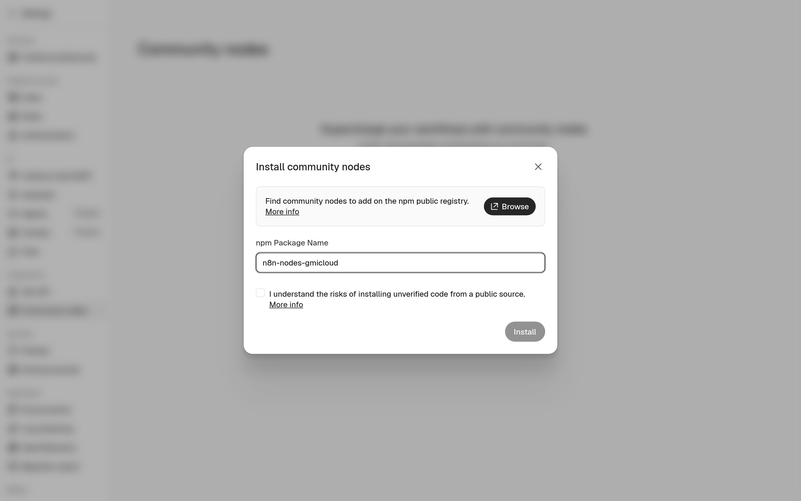
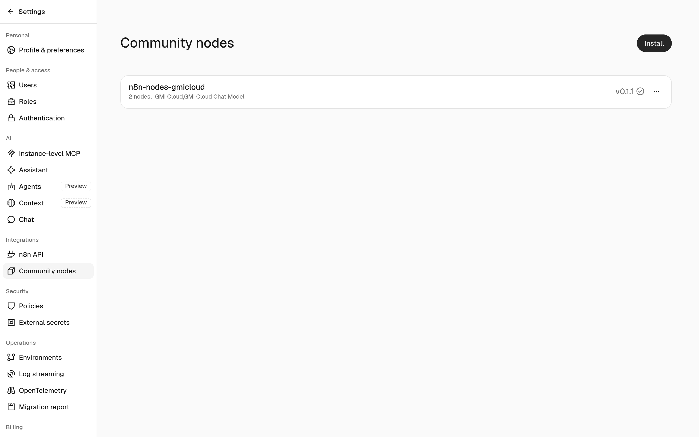
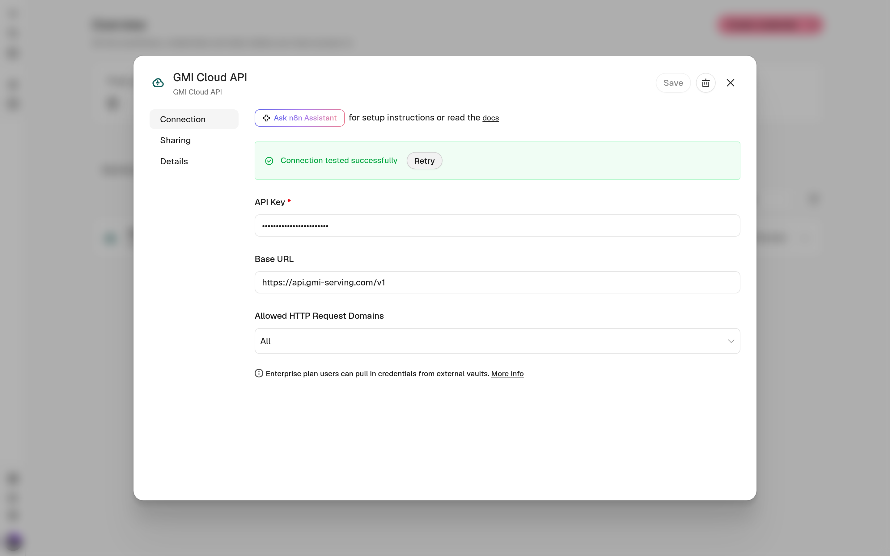
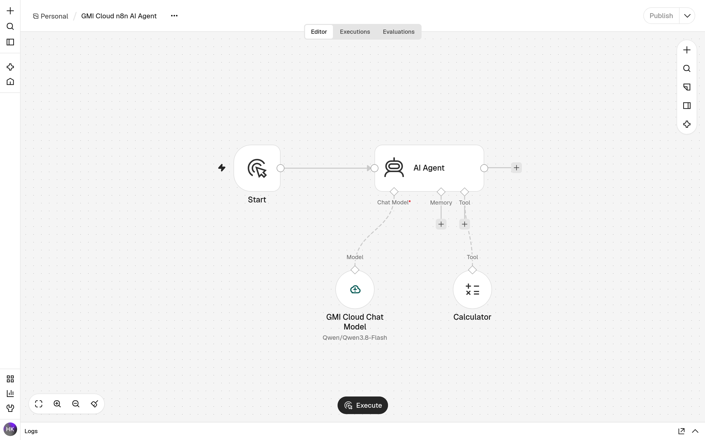
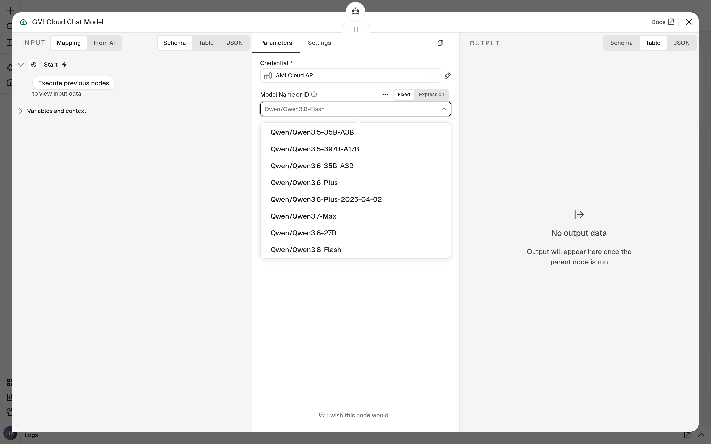
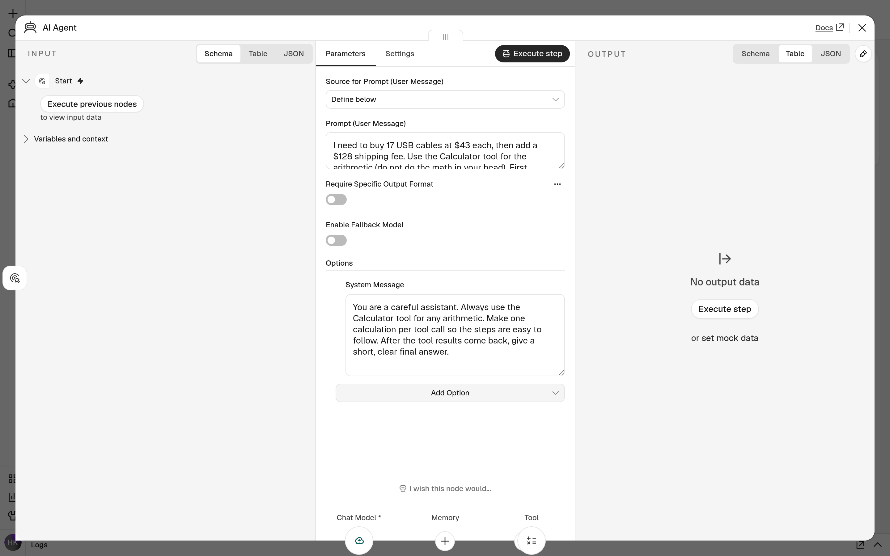
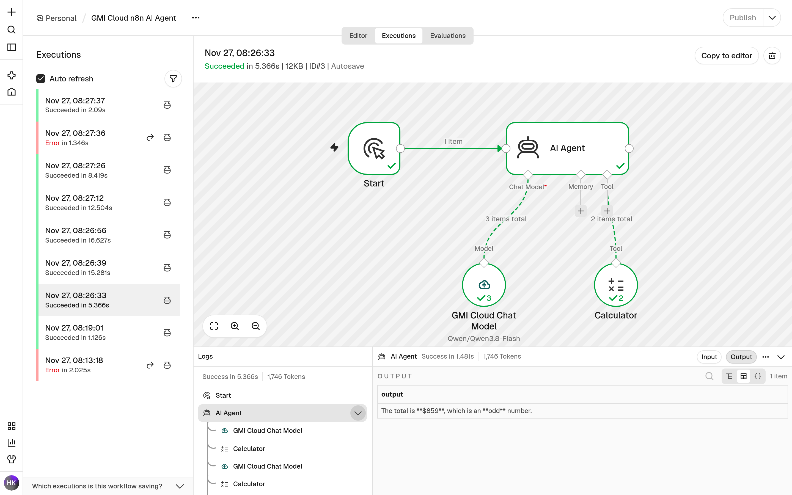
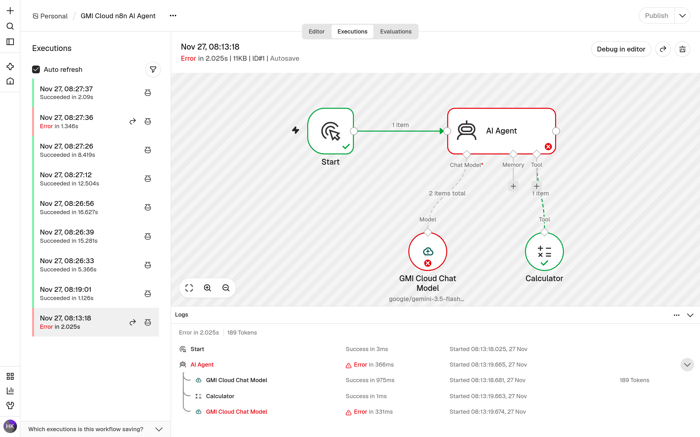

# Build an n8n AI Agent with GMI Cloud's community node

I wanted an n8n AI Agent that talks to [GMI Cloud](https://www.gmicloud.ai/) without me pasting a custom OpenAI base URL into the generic OpenAI credentials every time. So I built a community node for it, [n8n-nodes-gmicloud](https://www.npmjs.com/package/n8n-nodes-gmicloud), and ran a real agent workflow against GMI's inference API.

This post is the walkthrough: install the node, add a GMI Cloud API credential, attach **GMI Cloud Chat Model** to n8n's **AI Agent**, give the agent one tool, and run a short two-step task. All of the screenshots and numbers below are from a live run on my self-hosted n8n 2.49.7 instance on 27 November 2026 (Asia/Calcutta).

Disclosure: I'm a GMI Cloud Clouders ambassador. The community node is an independent project and is not published by GMI Cloud.

## What you'll end up with

A manual-trigger workflow with three moving parts:

- an **AI Agent** that owns the prompt
- **GMI Cloud Chat Model**, which is the language-model sub-node the agent actually calls
- n8n's built-in **Calculator** tool, so the model has to do the arithmetic in the open instead of guessing

The task I gave it: work out the cost of 17 USB cables at $43 each, add a $128 shipping fee, and say whether the total is even or odd. That's two calculator calls and a final answer.

You'll need a self-hosted n8n instance (or n8n Cloud, now that the package is on npm) and an API key from [console.gmicloud.ai](https://console.gmicloud.ai).

## 1. Install n8n-nodes-gmicloud

In n8n, open **Settings → Community nodes** and click **Install**. Enter the package name `n8n-nodes-gmicloud`, tick the box about installing unverified code from the public registry, and install.

After a few seconds the package shows up in the list as **v0.1.1**, with two nodes: **GMI Cloud** and **GMI Cloud Chat Model**. If the nodes don't appear in the palette, restart n8n once.

The first node is for one-shot chat completions and listing models. The second is the one we want today: a LangChain-compatible chat model you drop onto an AI Agent or a Basic LLM Chain.

## 2. Add your GMI Cloud API credentials

Still in n8n, create a **GMI Cloud API** credential. Paste the key from the GMI Cloud console and leave **Base URL** as `https://api.gmi-serving.com/v1` unless GMI has given you a dedicated endpoint. Save, then hit **Retry** / **Test**. n8n checks the key with `GET /v1/models`. You want the green "Connection tested successfully" banner.

The key is stored encrypted by n8n and sent as a Bearer token. Don't commit it, and don't drop it into screenshots.

When I tested this key against the live catalog it returned **71 models**.

## 3. Wire the chat model into an AI Agent

From a new workflow, add a **Manual Trigger** (I left mine named **Start**) and an **AI Agent**. On the agent's **Chat Model** connector, add **GMI Cloud Chat Model**. On the **Tool** connector, add **Calculator**. You can find both GMI nodes by searching the node panel for "GMI Cloud".

Open the chat model node, pick your **GMI Cloud API** credential, and choose a model from **Model Name or ID**. That dropdown is loaded live from GMI's `/v1/models` catalog, so the list you see is whatever your key can actually call.

I set **Maximum Tokens** to 1024 and **Sampling Temperature** to 0, so the run stayed cheap and the answer stayed deterministic.

## 4. Pick a cheap model, and watch max tokens on reasoning models

I first tried `google/gemini-3.5-flash-lite`, which is inexpensive and doesn't spend tokens on a hidden thinking trace. It got as far as the first calculator call, then n8n's OpenAI-compatible client failed the second model call with `400 Invalid thinking-block signature; retry on a compatible provider`. I'll come back to that in troubleshooting.

For the run in this post I switched to `Qwen/Qwen3.8-Flash`. It's still a Flash-class model, it used the Calculator cleanly, and with Maximum Tokens at 1024 it had enough room for both tool calls and a final sentence.

That token limit matters more than it sounds. Some reasoning models on GMI will spend `max_tokens` on hidden `reasoning_content` and return empty text if you set the cap too low. I reproduced this against the same API, outside n8n, before I built the workflow:

- `zai-org/GLM-5.3` with `max_tokens: 16` finished with `finish_reason: length`, an empty `content` string, and all 16 completion tokens counted as `reasoning_tokens`.
- `tencent/hy4-flash` with `max_tokens: 256` did the same thing at a larger budget: 256 completion tokens, all of them reasoning, and empty text.

If a run comes back blank, raise Maximum Tokens, or switch to a lighter non-reasoning model.

## 5. Give the agent a two-step task

In the AI Agent node, set **Source for Prompt** to **Define below** and paste a prompt that actually needs the tool twice. Here's the one I used:

> I need to buy 17 USB cables at $43 each, then add a $128 shipping fee. Use the Calculator tool for the arithmetic (do not do the math in your head). First compute 17 \* 43, then add 128 to that result in a second calculator call. Finally tell me the total in dollars and whether that total is even or odd.

I also set this **System Message**:

> You are a careful assistant. Always use the Calculator tool for any arithmetic. Make one calculation per tool call so the steps are easy to follow. After the tool results come back, give a short, clear final answer.

Then hit **Execute**.

## 6. The run

The workflow succeeded on 27 November 2026 at 8:26:33 AM IST (Asia/Calcutta), in **5.366 seconds**, and used **1,746 tokens**. That's execution ID #3 in the screenshot below. The Chat Model node ran three times (one call per agent step) and the Calculator ran twice.

The logs show the exact tool loop, and the agent's output is the real model text, markdown asterisks and all:

> The total is \*\*$859\*\*, which is an \*\*odd\*\* number.

The calculator inputs, from the execution data, were:

1. `17 * 43` → `731`
2. `731 + 128` → `859`

859 is odd, so the final sentence is correct. The three model calls used 556, 571, and 619 tokens respectively, which adds up to the 1,746 in the logs.

## How this differs from GMI's own n8n guide

GMI has a useful post, [Building an n8n AI Agent Workflow: Nodes, Patterns, and What n8n Can't Do Alone](https://www.gmicloud.ai/en/blog/n8n-ai-agent-workflow-nodes-patterns), about how an AI Agent is structured and where you'd point it at an OpenAI-compatible backend. That guide uses n8n's generic OpenAI / custom-model credentials and a base URL swap. This walkthrough is the other way in: a dedicated **GMI Cloud API** credential, a **GMI Cloud Chat Model** community node, and a model dropdown that reads your live catalog. Same inference API, less glue, and you don't have to remember to set `https://api.gmi-serving.com/v1` on a generic OpenAI node.

## Troubleshooting

**The agent errors after the first tool call with `Invalid thinking-block signature`.** I hit this with `google/gemini-3.5-flash-lite` at 8:13:18 AM IST on the same machine. The first Chat Model call and the first Calculator call succeeded (189 tokens in, then `17 * 43`), and the second Chat Model call failed. n8n's OpenAI-compatible client doesn't currently send Gemini's thinking-block signature back on the follow-up request. Switch to another catalog model — `Qwen/Qwen3.8-Flash` worked for me — and rerun.

**The model returns an empty string.** That's the reasoning-token issue above. Raise Maximum Tokens, or pick a model that doesn't spend the whole budget on hidden thinking.

**The credential test fails.** Confirm the key in [console.gmicloud.ai](https://console.gmicloud.ai) and that the base URL includes the `/v1` prefix: `https://api.gmi-serving.com/v1`.

**You can't see the GMI nodes after install.** Restart n8n, then search the node panel for "GMI Cloud". You should see both **GMI Cloud** and **GMI Cloud Chat Model**.

## Import the workflow

There's a credentials-free, gist-ready export in `workflow.json` alongside this draft. When you publish, upload that file as a gist or attach it to the post, then in n8n go to **⋯ → Import from file**, attach your **GMI Cloud API** credential to the chat model node, and execute. If you'd rather build it yourself, the node types are `@n8n/n8n-nodes-langchain.agent` (v3.1), `n8n-nodes-gmicloud.lmChatGmiCloud` (v1), and `@n8n/n8n-nodes-langchain.toolCalculator` (v1).

## Links

- npm: [n8n-nodes-gmicloud](https://www.npmjs.com/package/n8n-nodes-gmicloud)
- GitHub: [himanshu748/n8n-nodes-gmicloud](https://github.com/himanshu748/n8n-nodes-gmicloud)
- GMI Cloud console: [console.gmicloud.ai](https://console.gmicloud.ai)
- GMI Cloud LLM API reference: [docs.gmicloud.ai](https://docs.gmicloud.ai/inference-engine/api-reference/llm-api-reference)

If you try the workflow, I'd love to hear which model you landed on. I'm [@jhahimanshu653](https://x.com/jhahimanshu653) on X.
